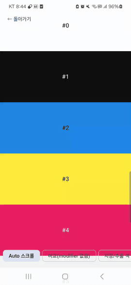
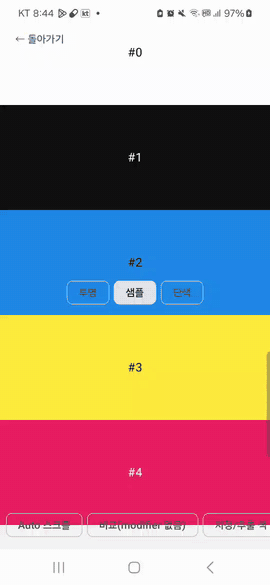

# systembars

edge-to-edge 앱에서 상태바 / 내비게이션바 **아이콘 명암**을 화면 배경에 맞춰 바꿔 준다.
배경색을 직접 지정하거나, 실제로 그려진 픽셀을 샘플링해서 자동으로 고른다.

`enableEdgeToEdge()` 는 바를 투명하게 만들 뿐 화면마다 다른 배경 위의 아이콘 명암은 맞춰 주지 않는다.
`SystemBarStyle.auto()` 는 시스템 다크 모드만 보고, Accompanist `SystemUiController` 는 deprecated 다.

> **상태.** `0.1.0` (초기 공개 버전, API 는 아직 바뀔 수 있다). Android 전용, minSdk 24.
> 설계 배경과 판단 근거는 [`ARCHITECTURE.md`](ARCHITECTURE.md) 참고.

## 미리보기

| Auto (스크롤) | BarPaint: 투명 → Sampled → Solid (상태바 + 내비바) |
|---|---|
|  |  |

## Setup

```kotlin
dependencies {
    implementation("io.github.sonms:systembars:0.1.0")
}
```

## 사용법

1. Activity 에서 `enableEdgeToEdge()` 를 **직접** 호출한다 (라이브러리는 하지 않는다. 미호출 시 디버그 로그로 경고).
2. 루트에 `SystemBarsHost` 를 한 번 둔다.
3. 화면에 `Modifier.systemBars(...)` 를 건다.

```kotlin
override fun onCreate(savedInstanceState: Bundle?) {
    super.onCreate(savedInstanceState)
    enableEdgeToEdge()
    setContent {
        SystemBarsHost {
            // 자동: 이 노드 안에 그려진 내용을 읽어 아이콘 명암을 고른다
            Box(Modifier.systemBars().fillMaxSize().background(color))
        }
    }
}
```

> **내비바에 회색/흰색 막이 덮여 있다면 `enableEdgeToEdge()` 의 기본 스크림이다.** 기본 호출은 API 29 미만(그리고 3버튼 +
> 대비 강제)에서 내비바에 반투명 스크림(밝은 모드 `0xE6FFFFFF`, 어두운 모드 `0x801B1B1B`)을 깐다. 콘텐츠나 `BarPaint` 를 그대로
> 보이게 하려면 투명으로 지정한다:
> `enableEdgeToEdge(navigationBarStyle = SystemBarStyle.auto(Color.TRANSPARENT, Color.TRANSPARENT))`,
> API 29+ 에서는 `SystemBarsConfig(contrastEnforced = false)` 도 필요하다. 스크림을 그대로 둘 때는 라이브러리가 그 색을 반영해 아이콘을 고른다.

> **modifier 순서가 중요하다.** `Auto` 는 modifier **안쪽**에 그려진 것만 읽는다.
> `systemBars()` 를 `background()` 보다 **앞에** 둘 것. 뒤에 두면 배경이 노드 밖이라 샘플이 비어 있다.

### `BarContent`

상태바와 내비바를 각각 지정한다: `Modifier.systemBars(status = ..., navigation = ...)`.

| 값 | 의미 |
|---|---|
| `Auto` (기본) | 노드 안에 그려진 Compose 내용을 샘플링 |
| `AutoWindow` | 실제 윈도우를 `PixelCopy` 로 샘플링 (API 26+). `SurfaceView` / 지도 / 비디오처럼 Compose 밖에서 그려진 영역용. 명시적 옵트인 |
| `Background(color)` | 바 뒤 배경이 `color` 라고 선언 (이미지 팔레트 추출 색 등) |
| `Light` / `Dark` | 바 뒤 배경이 밝다 / 어둡다. **배경의 톤**이다 (밝은 배경 → 어두운 아이콘) |
| `Inherit` | 아래 항목을 따른다 |

```kotlin
Modifier.systemBars(status = BarContent.Dark, navigation = BarContent.Inherit)
Modifier.systemBars(status = BarContent.Background(palette.dominant))
```

### 바 영역 칠하기 (`BarPaint`)

기본은 **칠하지 않음(투명)** 이라 바 뒤에는 콘텐츠가 그대로 비친다. 바 영역을 직접 칠하려면 `statusPaint` / `navigationPaint` 를 쓴다.

| 값 | 의미 |
|---|---|
| `None` (기본) | 칠하지 않는다 |
| `Sampled` | 샘플링한 바 뒤 콘텐츠의 평균색으로 단색 칠 (`Auto` 일 때만. 샘플 간격마다 갱신) |
| `Solid(color)` | 지정한 색으로 칠. `Auto` 와 함께 쓰면 **샘플링 없이** 이 색으로 아이콘 명암을 정한다 |

```kotlin
// 스크롤 콘텐츠가 바 밑으로 지나가도 상태바는 단색, 내비바는 투명
Modifier.systemBars(statusPaint = BarPaint.Solid(colorScheme.surface))

// 샘플 색을 단색 띠로 (이미지/그라데이션 위에서 바를 깔끔하게)
Modifier.systemBars(statusPaint = BarPaint.Sampled, navigationPaint = BarPaint.Sampled)

// 색 전환은 Compose 애니메이션으로
val bar by animateColorAsState(target)
Modifier.systemBars(statusPaint = BarPaint.Solid(bar))
```

- 윈도우 속성(`statusBarColor`)이 아니라 노드가 바 영역에 사각형을 한 번 더 그린다. 모든 API 레벨에서 같게 동작하고, API 35 의 edge-to-edge 강제와도 충돌하지 않는다.
- 그 바를 **결정하는(스택에서 이기는) 노드만** 칠하고, 노드가 바와 겹치는 범위에서만 칠한다. 칠한 색이 있으면 아이콘 명암은 칠한 색을 기준으로 정한다.
- `Sampled` 는 `AutoWindow` 와 같이 쓸 수 없다 (칠한 색이 윈도우 샘플에 다시 섞여 갱신되지 않음 → 무시).
- `Solid` 는 불투명한 색을 권장한다.

### 여러 개가 겹칠 때

한 윈도우의 레지스트리가 스택처럼 동작한다. **더 깊은 노드가 이기고, 깊이가 같으면 나중에 붙은 쪽이 이긴다.**
노드가 화면에서 사라지면 이전 항목으로 복귀한다. `Inherit` 는 바마다 따로 아래로 내려간다.

### Dialog

다이얼로그는 별도 윈도우라서 Activity 의 레지스트리를 보지 못한다. 전용 헬퍼를 쓴다.

```kotlin
SystemBarsDialog(
    onDismissRequest = { ... },
    properties = DialogProperties(decorFitsSystemWindows = false),
) {
    Box(Modifier.systemBars(BarContent.Dark, BarContent.Dark).fillMaxSize()) { ... }
}
```

## 설정

```kotlin
SystemBarsHost(
    config = SystemBarsConfig(
        intervalMillis = 300L,   // 샘플 최소 간격
        lowThreshold = 0.45f,    // 이보다 어두워지면 어두운 배경으로 전환
        highThreshold = 0.55f,   // 이보다 밝아지면 밝은 배경으로 전환 (사이는 직전 값 유지 = 히스테리시스)
        contrastEnforced = true, // Window.isNavigationBarContrastEnforced (API 29+)
        scrimModel = ScrimModel.AndroidxDefault, // null 이면 3버튼 스크림 보정 끔
    ),
) { ... }
```

### 3버튼 내비게이션

3버튼 모드에서는 시스템이 반투명 스크림을 깔기 때문에 "배경만 보고" 아이콘을 고르면 틀릴 수 있다.
`tappableElement` 인셋으로 3버튼을 감지해, 두 후보(어두운 아이콘 + 밝은 스크림 / 밝은 아이콘 + 어두운 스크림)를
각각 합성한 뒤 **대비율이 큰 쪽**을 고른다. 스크림 색은 플랫폼 내부 값이라 근사값이며 `ScrimModel` 로 교체하거나 `null` 로 끈다.

## 동작 방식

- 평소엔 `drawContent()` 만 한다. 샘플 시점에만 노드 캔버스를 16×160 소프트웨어 비트맵으로 잠깐 바꿔 한 번 더 그리고,
  바 아래 행만 읽는다. GPU read-back 이 없다.
- 샘플링 결과는 Compose `State` 가 아니라 윈도우 컨트롤러에 직접 적용한다. **리컴포지션을 일으키지 않는다.**
- 스크롤처럼 자식만 다시 그려지는 경우를 위해 윈도우의 프레임 콜백으로 샘플 시점을 잡는다.

## 한계

- **비용.** 샘플 1회는 S8(API 28, debug) 에서 약 4ms 지만 `invalidateDraw` 로 서브트리를 다시 기록하므로
  스크롤 중 프레임 꼬리가 늘어난다. S8 스크롤 측정(4라운드 중앙값):

  | | modifier 없음 | 간격 300ms | 간격 100ms |
  |---|---|---|---|
  | debug p95 / p99 | 약 19 / 26ms | 약 25 / 50ms | 약 42 / 63ms |
  | release p95 / p99 | 약 13 / 17.5ms | 약 20 / 31ms | 약 21 / 29ms |

  debug 에서는 간격을 늘리면 꼬리가 줄지만 release 에서는 300ms 와 100ms 가 구분되지 않는다(오버헤드 p95 약 +7ms, p99 약 +13ms).
  기본 간격은 300ms 다. jank 비율은 라운드 편차가 너무 커서 지표로 쓰지 않았다. 스크롤이 무거운 화면에서는 직접 측정할 것.
- `Auto` 는 **Compose 로 노드 안에 그려진 것만** 읽는다. blur / `RenderEffect` 같은 하드웨어 전용 효과, 노드 밖 배경,
  `SurfaceView` 는 반영되지 않는다 → `AutoWindow` 또는 `Background`.
- **API 28 이하 3버튼 내비바**: 시스템이 `navigationBarColor`(`enableEdgeToEdge()` 는 반투명 스크림) 로 바를 채우므로, 그 색을 스크림으로 보고 아이콘을 고른다. 투명하게 둔 경우에는 보정하지 않는다.
- `AutoWindow` 는 API 26 미만에서 동작하지 않는다. 샘플에 시스템 스크림이 이미 포함되므로 스크림 보정은 적용하지 않는다.
  `PixelCopy` 는 직전 프레임을 복사하므로 샘플 50ms 뒤 한 번 더 확인한다.
- `PixelCopy` 를 `Auto` 의 기본으로 쓰는 안은 S8 에서 측정했지만 canvas 방식보다 나아지지 않아 채택하지 않았다.
- 스크림 모델은 근사값이다. 기기마다 다를 수 있다.

## API 문서 (Dokka)

온라인: <https://sonms.github.io/Velvet-Compose/systembars/> (master 푸시 시 GitHub Pages 로 자동 배포)

```
./gradlew :systembars:dokkaGenerate   # build/dokka/html/index.html
```

공개 API 의 KDoc 은 저장소 관례대로 한국어 / 영어를 함께 적는다. 미문서화 항목은 Dokka 경고로 나온다.

## 테스트

```
./gradlew :systembars:testDebugUnitTest            # 휘도 / 히스테리시스 / 스크림 / 레지스트리 (JVM)
./gradlew :systembars:connectedDebugAndroidTest    # 샘플링 / 레지스트리 / 리컴포지션 / PixelCopy (실기기)
```

`:app` 의 **SystemBars** 버튼에서 스크롤 / 비교(modifier 없음) / 지정색 / Dialog / `SurfaceView` / 바 칠하기 데모를 볼 수 있다.
바 칠하기 화면은 투명 / 샘플 / 단색 칩과, 3버튼 내비바의 시스템 대비 스크림(흰 띠)을 끄고 켜는 `스크림 끄기` 칩이 있다(기본 꺼짐, `contrastEnforced = false`).
adb 로 바로 진입: `--es sample SYSTEM_BARS --es bars_demo SCROLL --el interval 300`.
